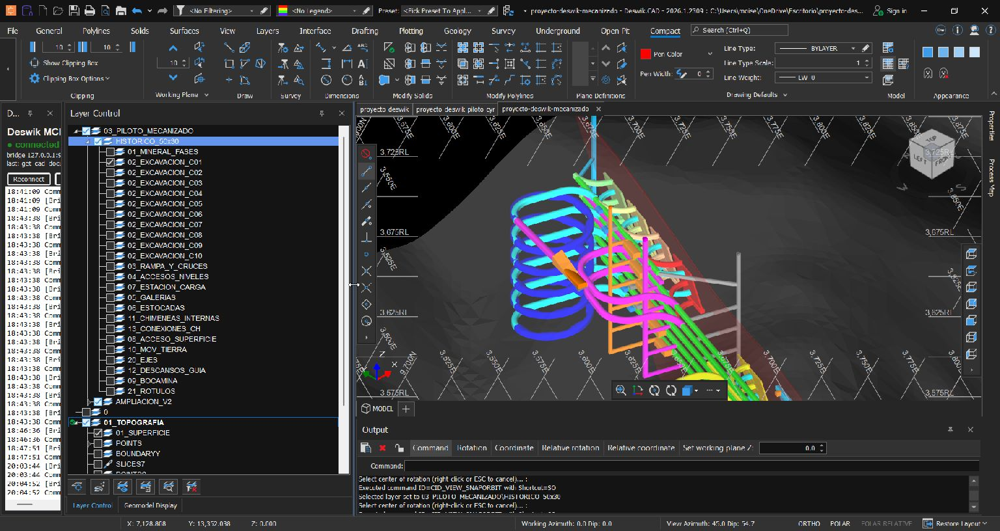
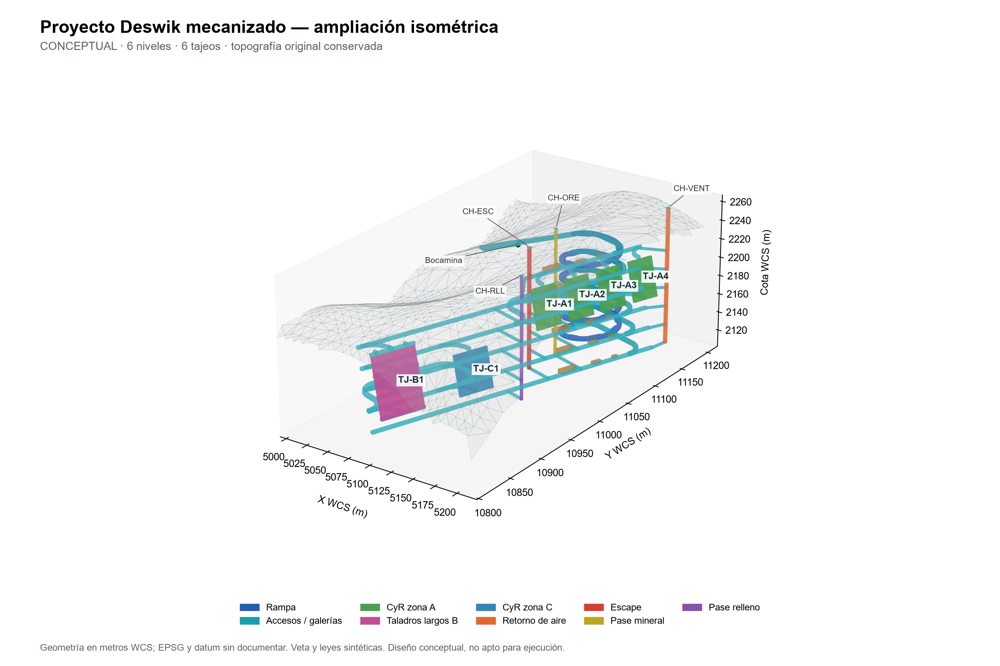
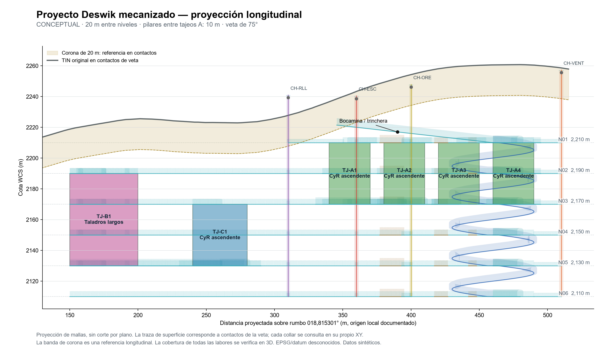

# proyecto-deswik

Avance al **9 de octubre de 2026, Lima**, de un proyecto conceptual de minería subterránea en **Deswik CAD 2026.1**.

El archivo vigente es **[06_PILOTO_MECANIZADO/proyecto-deswik-mecanizado.duf](06_PILOTO_MECANIZADO/proyecto-deswik-mecanizado.duf)**. Es el mismo proyecto que se ha ido mejorando, con topografía y veta conservadas. El DUF de la raíz y `05_PILOTO_CYR` documentan etapas anteriores.

## Avance del diseño

- **6 niveles**, cotas de piso 2210, 2190, 2170, 2150, 2130 y 2110 m WCS, sobre un sector de unos 340 m de rumbo.
- **Rampa mecanizada** de 4,5 × 4,5 m con arco, cinco vueltas de radio de eje 30 m, descansos y ensanches. Longitud 947,83 m y pendiente máxima 11,08%; accesos de nivel con radio mínimo de eje 20 m.
- **6 tajeos:** TJ-A1 a TJ-A4 y TJ-C1 de corte y relleno ascendente, con 12 cortes por tajeo; TJ-B1 de taladros largos, con subniveles cada 20 m y anillos dibujados como líneas.
- **Galerías, cruceros, estocadas, cámaras de carga, reservas de refugio y sumideros**, con sólidos cerrados, atributos y capas por método, nivel y función.
- **4 chimeneas hasta superficie:** ventilación, escape, pase de mineral y relleno, conectadas a los seis niveles.
- **Topografía, veta y 14.000 bloques originales preservados.** Los bloques siguen cubriendo el piloto de 50 × 30 m; no cubren todo el nuevo sector.

Cobertura vertical mínima comprobada de las labores ordinarias: 21,94 m. Cobertura geométrica de techo en el socavón de bocamina: 4,19 m; la competencia de la roca todavía debe validarse. Mineral conceptual: 12.656,2 m³ y 34.171,6 t usando densidad supuesta de 2,7 t/m³; relleno geométrico 22.268,6 m³. Las cantidades y supuestos completos están en el resumen y en el Excel.

## Imágenes del avance

### Captura real de Deswik CAD

Captura del proyecto abierto después de guardar; el encuadre es el que tenía la sesión del usuario y muestra parte del modelo.

### Vista isométrica del diseño

### Proyección longitudinal

Las dos últimas imágenes se generaron con las coordenadas y mallas verificadas. La longitudinal es una proyección sobre el rumbo, no una intersección por plano ni una sección nativa de CAD.

## Descargar y continuar

1. Descargar o clonar el repositorio completo.
2. Abrir [proyecto-deswik-mecanizado.duf](06_PILOTO_MECANIZADO/proyecto-deswik-mecanizado.duf) en Deswik CAD 2026.1. Conservar `06_PILOTO_MECANIZADO/01_datos` junto al DUF para su referencia relativa `Bloques_piloto.dm`.
3. Consultar el [resumen de la ampliación](06_PILOTO_MECANIZADO/03_documentacion/Ampliacion/Resumen_ampliacion.md) y las [mediciones editables](06_PILOTO_MECANIZADO/01_datos/Ampliacion/Mediciones_mecanizado.xlsx).
4. El ZIP de evidencia extensa se entrega en [partes verificadas](06_PILOTO_MECANIZADO/02_geometria/Ampliacion/Paquete_evidencia/README.md). Su reconstrucción es opcional para usar el DUF, los datos y las vistas.

| Carpeta | Contenido |
|---|---|
| [06_PILOTO_MECANIZADO](06_PILOTO_MECANIZADO/) | Proyecto vigente, bloques, topografía TIN, mediciones, geometría, informes y captura |
| [05_PILOTO_CYR](05_PILOTO_CYR/) | Antecedente del piloto de corte y relleno de 50 × 30 m |
| [01_datos](01_datos/), [02_geometria](02_geometria/), [03_documentacion](03_documentacion/) | Base geológica original y documentación histórica |
| [04_respaldo](04_respaldo/) | Respaldo histórico publicado en la primera entrega |

## Verificación y límites

La ampliación se revisó con 407 sólidos cerrados de volumen positivo, 383 polilíneas y 40 textos. Se comprobaron cobertura, ejes, pilares e interferencias; las conexiones y fases mutuamente excluyentes están identificadas. La carga en la sesión licenciada de Deswik también se comprobó. El último guardado para esta publicación se compara con esa revisión en [Verificacion_ultimo_guardado.json](06_PILOTO_MECANIZADO/03_documentacion/Publicacion/Verificacion_ultimo_guardado.json). Las fuentes oficiales peruanas y fichas de equipos están en [Criterios_y_fuentes.md](06_PILOTO_MECANIZADO/03_documentacion/Ampliacion/Criterios_y_fuentes.md).

**Diseño conceptual con geometría, leyes y densidad sintéticas, no apto para ejecución sin validación geotécnica, sostenimiento, ventilación, vías de escape y maniobras de equipos.** No constituye una estimación de recursos o reservas. Falta una sección longitudinal nativa de CAD y definir EPSG/datum. Los mínimos del encargo no se presentan como mínimos normativos universales.

Los archivos de respaldo automático, bloqueos, entornos, credenciales y componentes de software del PC no se incluyen en esta actualización. Los manifiestos históricos mantienen sus rutas y hashes de la etapa en que se generaron. El perfil de importación antiguo de `05_PILOTO_CYR` usa rutas absolutas que deben reajustarse en otro equipo; el DUF vigente enlaza el modelo de bloques por ruta relativa.
