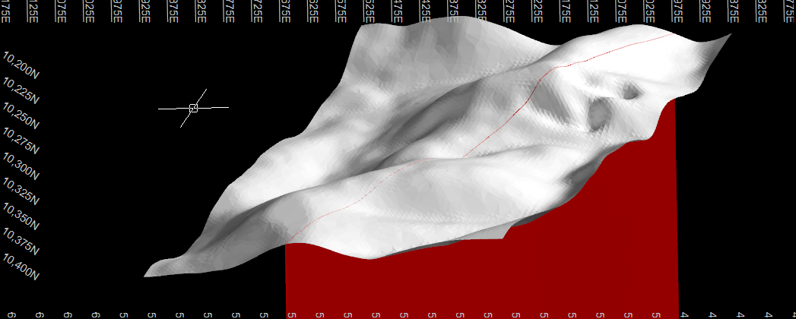

# proyecto-deswik

Proyecto independiente de minería subterránea desarrollado en **Deswik CAD 2026.1**. Esta versión reúne la topografía original y una veta conceptual con su geometría, atributos, exportaciones y evidencia de verificación. Se preparó el 5 de octubre de 2026 como copia independiente del proyecto de escritorio para continuar su desarrollo mediante GitHub.

## Avance actual

- **Topografía dentro del DUF principal:** superficie triangulada, objetos de puntos, curvas de nivel, anotaciones y secciones originales. Estos datos están en el mismo archivo que la veta; no se dispone de una exportación DXF independiente de la topografía en este repositorio.
- **Veta VETA_001:** buzamiento de 75°, dirección de buzamiento ESE (azimut 108.815301°), extensión vertical conceptual de 1000 m por debajo de la traza que pasa por la superficie y potencia verdadera variable de 1 a 3 m.
- **Sólido y superficie central:** capas separadas, geometría auxiliar DXF y comprobaciones de cierre, orientación y volumen del sólido. Volumen geométrico: 2537039.801976 m³.
- **Datos:** ficha CSV con 16 campos, diccionario y atributos incorporados al sólido. Au 4.2 g/t, Ag 65 g/t y densidad 2.7 t/m³ son ejemplos sintéticos, sin muestreo ni ensayes; el tonelaje calculado también es un ejemplo. La potencia variable es una hipótesis geométrica.
- **Organización:** 22 capas nativas, grupos de topografía, geología, referencias y guías, respaldos y documentación de procedencia.

**Todavía no se ha diseñado una rampa ni elegido un método de explotación.** No hay modelo de bloques, interpolación de leyes ni clasificación de recursos o reservas. Esta es una base conceptual de trabajo; no constituye un diseño listo para ejecución ni una estimación mineral validada.

## Vista de referencia

Captura aportada durante el trabajo local. Sirve para identificar el modelo; no reemplaza la revisión de la geometría en Deswik.

## Archivos

| Ruta | Contenido |
|---|---|
| [proyecto-deswik.duf](proyecto-deswik.duf) | Proyecto principal: topografía, veta y atributos nativos |
| [01_datos](01_datos/) | Ficha de ejemplo y diccionario de atributos |
| [02_geometria](02_geometria/) | DXF del sólido con superficie central y DXF de guías |
| [03_documentacion](03_documentacion/) | Ficha, procedencia, verificaciones, inventarios y vista de referencia |
| [04_respaldo](04_respaldo/) | Versión anterior a la organización de capas |

El repositorio conserva los datos y documentos del proyecto. No incluye entornos Python, configuración personal de Codex, credenciales, add-ins comunitarios ni archivos temporales de bloqueo o respaldos automáticos de Deswik. Las herramientas y habilidades preparadas en el PC están descritas en [Herramientas_y_habilidades.md](03_documentacion/Herramientas_y_habilidades.md); ese documento registra la instalación local, no instala componentes en otra máquina.

## Abrir y continuar

1. Descargar o clonar el repositorio completo.
2. Abrir **proyecto-deswik.duf** en Deswik CAD. La referencia de versión usada es 2026.1; no se ha probado compatibilidad con otras versiones.
3. Consultar [Veta_ficha.md](03_documentacion/Veta_ficha.md) y [Diccionario_atributos.csv](01_datos/Diccionario_atributos.csv) antes de modificar o importar datos.
4. Trabajar sobre el DUF principal y guardar los cambios. El archivo de `04_respaldo` conserva una etapa anterior.

Las capas principales son `01_TOPOGRAFIA`, `02_GEOLOGIA_VETA_001`, `03_REFERENCIAS`, `04_SUPERFICIES_AUX` y `90_GUIAS_VETA`. El sólido está en `02_GEOLOGIA_VETA_001\01_SOLIDO_POT_1_3M`; la superficie central está en `02_GEOLOGIA_VETA_001\02_SUPERFICIE_CENTRAL`. Las curvas y objetos de puntos pueden estar ocultos: consultar [Inventario_capas.csv](03_documentacion/Inventario_capas.csv).

Identificador del sólido: `VETA_ID=VETA_001`, GUID `1387534c-b5c9-4846-b6c5-8d2e859c9c84`, handle guardado `2676` decimal / `A74` hexadecimal. Un handle puede cambiar al editar; comprobar la identidad antes de volver a importar la ficha por HANDLE.

Los CSV usan coma y punto decimal. Los 16 atributos de Deswik se guardaron como texto: convertir explícitamente los campos numéricos antes de calcular y conservar los datos ausentes como ausentes. Los metros proceden del diccionario y la procedencia; el DXF R12 auxiliar no declara INSUNITS. No se ha identificado en la documentación un sistema de referencia geodésico para reinterpretar las coordenadas.

## Evidencia y trazabilidad

- [Verificacion_proyecto_deswik.json](03_documentacion/Verificacion_proyecto_deswik.json): lectura nativa del proyecto guardado, capas, sólido y atributos.
- [Procedencia_del_modelo.md](03_documentacion/Procedencia_del_modelo.md): construcción, copias y cambios de identificadores.
- [Inventario_archivos_sha256.csv](03_documentacion/Inventario_archivos_sha256.csv): tamaños y hashes de los archivos de esta copia, sin incluir el propio inventario ni `.git`.
- [Verificacion_copia_publicacion.json](03_documentacion/Verificacion_copia_publicacion.json): comprobación de integridad al preparar la copia independiente.
- [README_paquete_escritorio_original.md](03_documentacion/README_paquete_escritorio_original.md): instrucciones originales del paquete local, preservadas como documento histórico.

Los manifiestos y verificaciones anteriores conservan sus rutas locales y nombres de capa de la etapa en que se generaron. No son rutas que deban existir en el equipo de quien descargue el repositorio. Los archivos con sufijo `_original` son evidencia histórica; el DUF de la raíz y la ficha CSV de `01_datos` corresponden al estado organizado.

## Próximos pasos

Incorporar información trazable de geología, muestreo, geotecnia y topografía; revisar continuidad y potencia de la veta; y comparar métodos de explotación cuando existan los datos necesarios. El diseño de accesos, rampas, niveles y tajos se definirá después con parámetros de proyecto acordados y verificaciones específicas.
